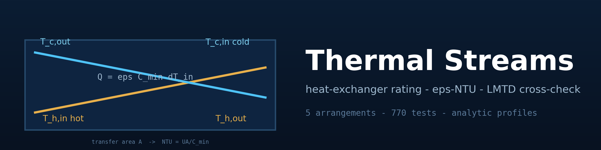
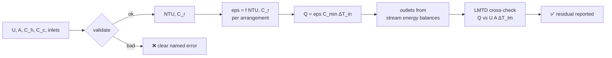
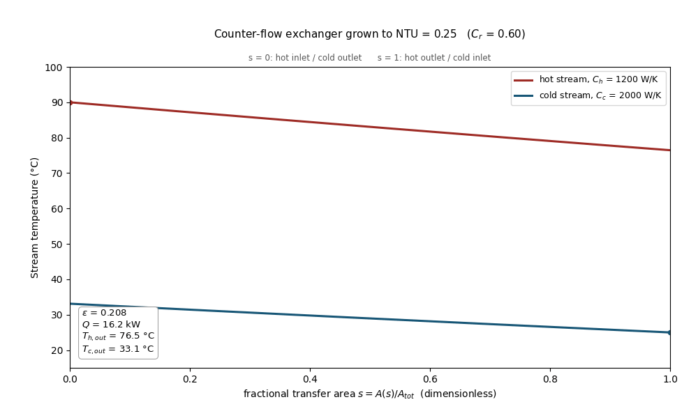
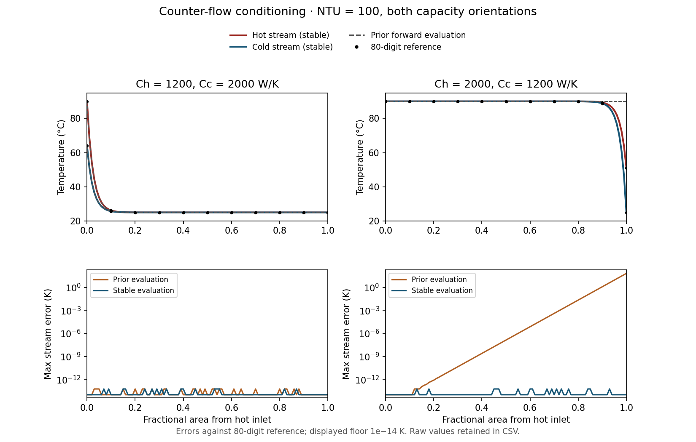

<div align="center">



# 🌡️ Thermal Streams

### Heat-exchanger rating, conditioned temperature profiles & numerical checks

**An original Python/NumPy implementation of the effectiveness-NTU method: exact
closed-form relations for five arrangements, an independent LMTD cross-check, and
analytic counter-flow profiles — verified by 770 parametrized tests.**

[](https://github.com/khalil-work/thermal-streams/actions/workflows/ci.yml)
[](LICENSE)
[](requirements.txt)
[](tests)
[](docs/verification.md)
[](https://github.com/khalil-work/thermal-streams/stargazers)
[](https://github.com/khalil-work/thermal-streams/commits)

[Homepage](https://khalil-work.github.io) · [Quick start](#-quick-start) · [Model](#-model-summary) · [Animation](#%EF%B8%8F-results-gallery) · [Conditioning](#-why-numerical-conditioning-matters) · [References](#-references)

</div>

---

## 🎯 Purpose and scope

Thermal Streams is an original Python/NumPy implementation of heat-exchanger
analysis by the **effectiveness-NTU method**:

- exact closed-form effectiveness relations `eps = f(NTU, C_r)` for **parallel flow**
  and **counter flow** (including the equal-capacity limit eps = NTU/(1+NTU)), the
  **C_r = 0 condenser/evaporator idealization** eps = 1 − exp(−NTU) as a correctness
  anchor, a one-shell-pass **shell-and-tube** relation, and the two single-pass
  **crossflow with exactly one fluid mixed** relations — every formula stated with
  its validity domain in [docs/model.md](docs/model.md);
- the rating solution Q = eps C_min dT_in with outlet temperatures from energy
  balances on both streams, with input validation and clear errors;
- an independent **LMTD formulation** as the strongest cross-check;
- analytic position-resolved counter-flow temperature profiles;
- a verification suite (770 parametrized pytest items, not experiments) and a
  results generator producing figures, a heat-balance table and the animation below.

| Arrangement | eps relation |
| --- | --- |
| Parallel | [1 − exp(−NTU(1+C_r))] / (1+C_r) |
| Counter, C_r < 1 | [1 − exp(−NTU(1−C_r))] / [1 − C_r exp(−NTU(1−C_r))] |
| Counter, C_r = 1 | NTU / (1 + NTU) |
| C_r = 0 anchor (all) | 1 − exp(−NTU) |
| Shell-and-tube / crossflow | see [docs/model.md](docs/model.md) with validity domains |

## 🧮 Model summary

```
C_r  = C_min / C_max            (0 <= C_r <= 1)
NTU  = U A / C_min
eps  = Q / (C_min (T_h,in - T_c,in))

Q        = eps C_min (T_h,in - T_c,in)
T_h,out  = T_h,in - Q / C_h          T_c,out = T_c,in + Q / C_c
```

The eps-NTU duty is cross-checked against Q = U A dT_lm with
dT_lm = (dT_1 − dT_2)/ln(dT_1/dT_2) built from the same outlet temperatures — an
independent mathematical route to the same answer. Full derivations, validity
domains, symbols and units: [docs/model.md](docs/model.md).

### Rating pipeline



## ⚡ Quick start

```bash
git clone https://github.com/khalil-work/thermal-streams.git
cd thermal-streams
python -m venv .venv
# Windows: .venv\Scripts\activate
# Linux/macOS: source .venv/bin/activate
python -m pip install -r requirements-dev.txt
python -m pytest -q
python examples/run_verification.py
```

Runtime requirements: `numpy==2.1.3`, `matplotlib==3.10.0`, `pillow==11.0.0`
(matplotlib/pillow only for the results script); tests need `pytest==8.3.4`.
CI runs the suite on ubuntu-latest / Python 3.12.

<details>
<summary><b>🧱 Architecture and API example</b></summary>

```
thermal_streams/
    core.py       # eps relations, validation, rating solver, LMTD
    profiles.py   # analytic counter-flow temperature profiles
tests/            # 770 verification items (see docs/verification.md)
examples/run_verification.py   # regenerates every artifact in docs/results/
docs/             # model.md, api.md, verification.md, results/
```

```python
from thermal_streams import ExchangerConfig, solve_exchanger

cfg = ExchangerConfig(flow="counter", U_W_m2K=800.0, A_m2=6.0,
                      C_h_W_K=1200.0, C_c_W_K=2000.0,
                      T_h_in_K=363.15, T_c_in_K=298.15)
res = solve_exchanger(cfg)
print(f"NTU        = {res.ntu:.3f}")
print(f"C_r        = {res.c_r:.3f}")
print(f"effectiveness = {res.effectiveness:.6f}")
print(f"duty       = {res.duty_W:.1f} W")
print(f"T_h_out    = {res.T_h_out_K - 273.15:.2f} degC")
print(f"T_c_out    = {res.T_c_out_K - 273.15:.2f} degC")
print(f"energy-balance residual = {res.energy_balance_residual_W:.2e} W")
```

Executed output (Python 3.13.5, numpy 2.1.3, Windows 11):

```
NTU        = 4.000
C_r        = 0.600
effectiveness = 0.908110
duty       = 70832.6 W
T_h_out    = 30.97 degC
T_c_out    = 60.42 degC
energy-balance residual = 2.91e-11 W
```

Full API: [docs/api.md](docs/api.md).

</details>

## 🔬 Why numerical conditioning matters

For the cold stream carrying C_min at NTU=100, the original forward evaluation
rounded a tiny terminal temperature difference to zero and then amplified that loss
of information. It returned a **90°C cold inlet instead of 25°C**. The repaired
method starts from the better-conditioned end and integrates a decaying exponential.
Across the 15 saved cases, the largest temperature deviation from the 80-digit
reference is **5.7e-14 K** (prior error up to 65 K, preserved explicitly as an
obsolete comparison path). This is an equation/implementation check, not a physical
accuracy claim. The independent RK4 tests also integrate in the decaying direction
for both capacity assignments.

[Comparison values](docs/results/conditioning_profiles.csv) ·
[Case-by-case metrics](docs/results/conditioning_metrics.json) ·
[Reference and obsolete comparison code](examples/stability_reference.py)

## ✅ Verification summary

- **Energy balance** closes exactly to roundoff on both streams for every
  configuration across the sweeps.
- **Limits:** parallel-flow eps_max = 1/(1+C_r) exactly; counter-flow eps → 1 with
  the analytic asymptotic gap; equal-capacity branch; NTU → ∞ limits of the
  additional arrangements; thermodynamic ordering parallel ≤ arrangement ≤ counter;
  universal small-NTU expansion.
- **C_r = 0 anchor** eps = 1 − exp(−NTU) reproduced by every arrangement and the
  full solver.
- **LMTD cross-check:** Q(eps-NTU) = Q = U A dT_lm to better than 1e-10 relative
  for counter flow (including the degenerate C_r = 1 case).
- **Profiles:** endpoints match the rating solution, incremental energy balance
  holds at every station, and a hand-written RK4 integration of the governing ODEs
  reproduces the profiles and lands on the far-end boundary conditions.
- **Monotonicity** of eps in NTU for every arrangement, and full input validation.

Details and the exact sweeps: [docs/verification.md](docs/verification.md).

## 🔎 Limitations

No pressure drop, no fouling, no axial conduction, no ambient heat loss; constant
properties and uniform U; no phase change except the C_r = 0 idealization;
configurations limited to the five implemented arrangements; LMTD route exact only
for parallel and counter flow (no F-factor method). See the end of
[docs/verification.md](docs/verification.md).

---

## 🎞️ Results gallery

<div align="center">

**▶ Watch the profiles grow with NTU:**



[▶ Open the 48-frame GIF](docs/results/counterflow_profiles_ntu.gif) ·
[Every frame's temperature data](docs/results/animation_profiles.csv)

<sub>Provenance: a computed result generated by
<code>examples/run_verification.py</code>. Each of the 48 frames
(1000 x 600 px, 8 fps) solves the counter-flow eps-NTU model
(numpy 2.1.3, matplotlib 3.10.0) for U = 800 W/(m² K), C_h = 1200 W/K,
C_c = 2000 W/K, T_h,in = 90 °C, T_c,in = 25 °C and plots the analytic
stream-temperature profiles over the fractional transfer area s ∈ [0, 1]
while the surface area grows so that NTU sweeps 0.25 → 12 (geometric).
The reported eps, duty and outlet temperatures are recomputed for every
frame. The animation compares steady exchangers with increasing area; it
is not a transient heating simulation.</sub>

</div>

### 🖼️ Static figures & metrics



| Metric | Value | How measured |
|---|---|---|
| Test suite | **770 passed**, 0 failed | `pytest -q`, this repository |
| Max energy-balance residual | **3.5e-10 W** (3.7e-14 relative) | 3000-case sweep, all 5 arrangements, NTU ≤ 100 |
| eps-NTU vs LMTD duty agreement, counter flow | **2.8e-11** relative max | 528 cases, C_r 0.05–1 (incl. 1.0), NTU ≤ 15.8 |
| eps-NTU vs LMTD duty agreement, parallel flow | 1.9e-12 relative max | 440 cases, well-conditioned range NTU ≤ 5 |
| C_r = 0 anchor agreement | 1.2e-9 max abs deviation | 300 cases with C_max = 1e12 W/K stream |
| Documented case | eps = 0.908110, Q = 70.83 kW | counter flow, NTU = 4, C_r = 0.6 |
| Profile agreement with 80-digit arithmetic | **5.7e-14 K** max absolute error | 15 cases: NTU 4/50/100, both capacity orientations |
| Prior forward-evaluation error on the same cases | up to 65 K | preserved explicitly as an obsolete comparison path |
| Animation | 48 distinct frames, 1000 x 600 px | actual profile data saved at every station |

Numbers are written by `examples/run_verification.py` into
[docs/results/run_summary.json](docs/results/run_summary.json) at generation time.

## 📚 References

- Incropera, DeWitt, Bergman & Lavine — *Fundamentals of Heat and Mass Transfer*.
- Shah & Sekulic — *Fundamentals of Heat Exchanger Design*.
- R. K. Shah, "The interrelation of effectiveness-NTU and LMTD methods"
  (cross-route agreement context).

## 🔑 License

MIT — see [LICENSE](LICENSE). Copyright (c) 2026 KHALIL.

[Calendar metadata disclosure](docs/CALENDAR_HISTORY.md).
